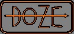

# doze



A minimal, extensible build system for file-based pipelines.

# Development

`doze` is work-in-progress. Expect breaking changes. May be unstable.

# Example

```yaml
rules:
  - do: libs:tcc:object_file
    inputs: [main.c, my_header.h]
    in: src/
    outputs: [main.o]
    out: build/

  - do: libs:tcc:executable
    inputs: [main.o]
    in: build/
    outputs: [a.out]
```
